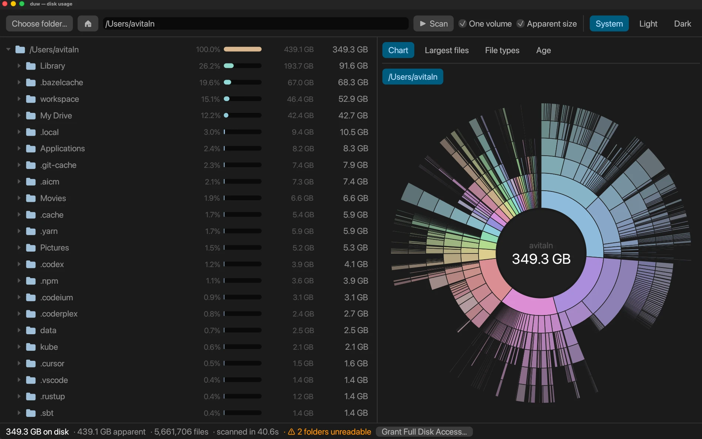

# duw

See what is really using your Mac's disk.

duw is a disk usage viewer in the spirit of JDiskReport, with one important
difference: it measures **actual space on disk**, not logical file size. Sparse
files such as Docker and VM disk images count only the blocks they occupy, so a
"100 GB" Rancher Desktop disk that stores 1.5 GB shows as 1.5 GB.



## Install

1. Download `duw-<version>.dmg` from the [latest release](../../releases/latest).
2. Open it and drag **duw** onto the **Applications** shortcut.
3. The first time only: macOS will say it can't verify the developer, because
   duw isn't signed with an Apple Developer ID. Right-click **duw** in
   Applications and choose **Open**, then **Open** again. (Or try to open it,
   then go to **System Settings → Privacy & Security** and click
   **Open Anyway**.) After that it opens normally.
4. Optional, to scan everything: when the status bar says some folders are
   unreadable, click **Grant Full Disk Access…**, switch **duw** on in the list
   that opens (add it with **+** if it isn't there), and scan again.

Requires an Apple Silicon Mac. **Move to Trash** needs macOS 15 or later.

## What it does

- **Folder tree** sorted by space on disk, with each item's share of its parent,
  and the apparent (logical) size alongside. Tags mark **sparse** files,
  **online only** cloud placeholders, and folders it had **no access** to.
- **Ring chart** of the selected folder: click a slice to zoom in, the centre to
  go up.
- **Largest files**, **File types** and **Age** views.
- Right-click anything to **Reveal in Finder**, **Open**, **Copy path** or
  **Move to Trash** (also ⌘⌫). Sizes update immediately, without a rescan.
- Light, dark or system appearance, remembered between launches.

### How sizes are counted

- Sizes are allocated blocks, the same as `du`. Finder's "Size" and `ls -l`
  show logical length instead.
- Hard-linked files are counted once.
- Scanning `/` doesn't double count: `/Users`, `/Applications` and the other
  firmlinks into the Data volume are walked once.
- **One volume** (on by default) stays on the disk you started from, so
  external, network and disk-image volumes are skipped.
- Cloud folders (Google Drive, iCloud Drive, Dropbox, OneDrive) count what is
  stored locally. Online-only placeholders count as 0 and are never downloaded.

## Build from source

You need Rust (`rustup`) and the Xcode command-line tools.

```bash
git clone https://github.com/avitaln/duw.git
cd duw
./install.sh
```

`install.sh` builds `duw.app` and copies it into `/Applications`. A copy you
build yourself opens without the developer warning.

To keep Full Disk Access across rebuilds, create a code-signing certificate
once: in **Keychain Access**, choose **Certificate Assistant → Create a
Certificate…**, name it `duw Local Signing`, set Identity Type to **Self Signed
Root** and Certificate Type to **Code Signing**. The scripts use it when it
exists and sign ad hoc otherwise.

`./package.sh` builds the distributable `target/duw-<version>.dmg`.
